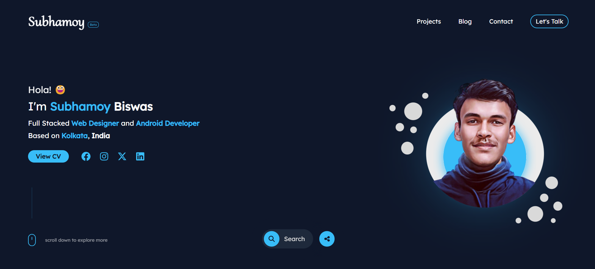

# Subhamoy Biswas - Portfolio Website

### Official Portfolio Website of Subhamoy Biswas (@neo_subhamoy)
[](https://github.com/neosubhamoy/neosubhamoy-portfolio/)
[](https://github.com/neosubhamoy/neosubhamoy-portfolio/)
[](https://github.com/neosubhamoy/neosubhamoy-portfolio/)

> [!WARNING]
> This project is archived and no longer actively maintained. Check-out it's successor: [neosubhamoy-website](https://github.com/neosubhamoy/neosubhamoy-website)

### 👀 Preview



### 📌 Tech Stack


### 🛠️ Contributing

Want to be the part of this project? Get started by following this simple steps . . .

1. Clone this repository (requires PHP 8.4+, Composer and Node.js)
2. Install composer and node dependencies, and create a `.env` file from `.env.example`

```code
composer install
npm install
```
3. Run the tailwind watcher and the PHP dev server (in two terminals)
```code
npm run dev
npm run serve
```
4. Website will be running on this url
```code
http://localhost:8000
```
5. Site content (projects, socials, pages, profiles etc.) lives in `data/site.json`
6. The site is hosted on [Vercel](https://vercel.com) using the [vercel-php](https://github.com/vercel-community/php) runtime (see `vercel.json`), set the variables from `.env.example` in the Vercel project settings

⭕ Noticed any Bugs? or Want to give me some suggetions? always feel free to open an issue...!!

### 📝 License & Usage

Subhamoy Biswas - Portfolio Website is a Fully Open Sourced Project licensed under MIT License but still some parts of this website are not allowed to use or distribute without proper permission or attribution. All the contents (eg: informations, blog posts, articles) published in this website and the visual components (eg: layout, design, animations, images, videos, graphics) used in this website are not covered under the MIT License and requires special permission to be used. Using these without prior permission will cause legal actions.

**🌟 Liked this project? Please consider giving it a star to show me your appreciation.**

****

An Open Sourced Project - Developed with ❤️ by **Subhamoy**